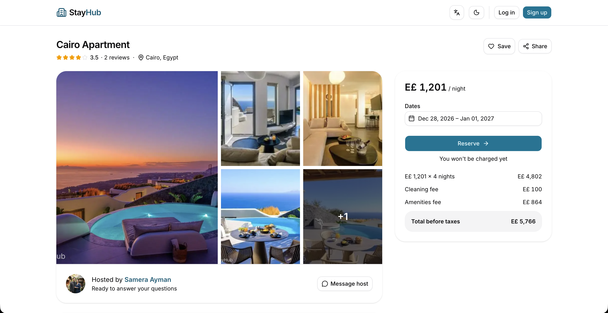
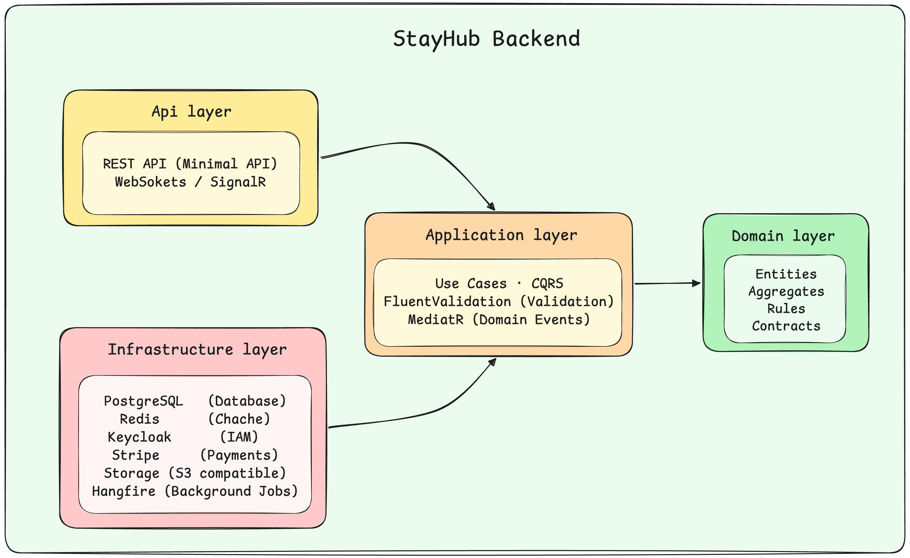

# StayHub Backend

**StayHub.Backend** provides a RESTful API for an apartment reservation platform. The backend separates business logic from infrastructure concerns and integrates authentication, caching, background processing, payments, and real-time communication.

[Backend Repository](https://github.com/AbdelrahmanTaymour/StayHub.Backend) · [Frontend Repository](https://github.com/AbdelrahmanTaymour/StayHub.UI) · [Docker Image](https://hub.docker.com/r/ataymour/stayhub-backend)


---

## Overview

Many property owners have apartments that stay empty for months without generating any income, while travelers often struggle to find trusted places to stay. StayHub aims to solve this problem by making it easy for property owners to rent out their apartments and for guests to discover, book, and manage their stays in one place.



The solution uses **Clean Architecture** and **MediatR** to handle application requests and domain events, **Entity Framework Core** for write operations, and **Dapper** for optimized read queries where appropriate.

## Features

- **Apartment Management** — Create, update, browse, and manage apartment listings.
- **Booking Management** — Handle reservations, booking statuses, and availability.
- **Authentication & Authorization** — Integrate Keycloak using OAuth 2.0 and OpenID Connect.
- **Payments** — Integrate Stripe for payment processing.
- **Reviews & Favorites** — Support guest reviews and saved apartments.
- **Real-Time Messaging** — Use SignalR for guest–owner conversations.
- **Notifications** — Support notification workflows and background processing.
- **Caching** — Use Redis to reduce repeated database queries, considering cache invalidation.
- **Background Jobs** — Use Hangfire for scheduled and asynchronous processing.
- **Object Storage** — Store apartment images in S3-compatible storage and serve them through presigned URLs.
- **Observability** — Use Serilog for structured logging, with Seq for log collection and inspection.

## Architecture

StayHub follows Clean Architecture to separate business rules, application workflows, and external infrastructure.

<p align="center">
  
</p>

### Architectural Principles

- **Clean Architecture:** Keep business logic independent of infrastructure implementations.
- **Domain-Driven Design:** Encapsulate business rules within domain entities and aggregates.
- **CQRS:** Separate read and write workflows where it provides a practical benefit.
- **Domain Events:** Coordinate domain-related workflows without tightly coupling their handlers to the originating operation.
- **Dependency Inversion:** Define application abstractions and implement infrastructure integrations separately.
- **Separation of Concerns:** Keep API endpoints, application use cases, domain rules, and infrastructure responsibilities distinct.

## Technology Stack

| Category | Technologies |
|---|---|
| Backend | C#, ASP.NET Core 10 |
| Architecture | Clean Architecture, DDD, CQRS |
| Application | MediatR, FluentValidation |
| Data Access | Entity Framework Core, Dapper |
| Database | PostgreSQL |
| Caching | Redis |
| Identity | Keycloak, OAuth 2.0, OpenID Connect |
| Payments | Stripe |
| Real-Time Communication | SignalR |
| Background Processing | Hangfire |
| Object Storage | S3-compatible storage, AWS SDK |
| Logging | Serilog, Seq |
| Containers | Docker |
| CI/CD | GitHub Actions |
| Testing | xUnit, FluentAssertions, NSubstitute, Testcontainers |

## Run with Docker Compose

The repository includes a Compose setup that pulls the published backend image and starts the supporting services.

### Prerequisites

- Docker Desktop or Docker Engine with Docker Compose
- Git

### 1. Clone the repository

```bash
git clone https://github.com/AbdelrahmanTaymour/StayHub.Backend.git
cd StayHub.Backend
```

### 2. Configure the environment

Ensure `docker/keycloak/realm.json` exists. It contains the Keycloak realm configuration required by the application.

Create your local environment file:

```bash
cp .env.example .env
```

Review `.env` and configure the credentials needed for the integrations you want to test.

### 3. Start the application

```bash
docker compose up -d
```

To inspect the API logs:

```bash
docker compose logs -f api
```

### 4. Explore the services

| Service | Local URL |
|---|---|
| API | [localhost:5236](http://localhost:5236) |
| Swagger UI | [localhost:5236/swagger](http://localhost:5236/swagger) |
| Health Check | [localhost:5236/health](http://localhost:5236/health) |
| Keycloak | [localhost:18080](http://localhost:18080) |
| Mailpit | [localhost:8025](http://localhost:8025) |
| Seq | [localhost:5341](http://localhost:5341) |

Swagger and automatic database migrations are configured for the Development environment. This setup is intended for local evaluation, not production deployment.

### Stop the application

```bash
docker compose down
```

To also delete persisted database and service data:

```bash
docker compose down -v
```

**Warning:** The second command deletes the named volumes and their stored data.

## Credentials and External Services

Only configure real credentials for the integrations you intend to exercise. Keep them in `.env`

<details>
<summary><strong>Keycloak — client secrets</strong></summary>

1. Open the Keycloak Admin Console at `http://localhost:18080`.
2. Select the `StayHub` realm.
3. Open **Clients** and select `stayhub-auth-client`.
4. If the client uses client authentication, open **Credentials** and copy its secret.
5. Repeat for `stayhub-admin-client` if required.
6. Add the values to `.env`:

```dotenv
KEYCLOAK_AUTH_CLIENT_SECRET=your_auth_client_secret
KEYCLOAK_ADMIN_CLIENT_SECRET=your_admin_client_secret
```

Use secrets that match the imported realm configuration.

</details>

<details>
<summary><strong>IDrive e2 — object storage</strong></summary>

1. Sign in to [IDrive e2](https://www.idrive.com/s3-storage-e2/).
2. Open access-key management and create a key with the permissions required by your media bucket.
3. Save the access key ID and secret access key.
4. Configure `.env`:

```dotenv
STORAGE_ACCESS_KEY=your_access_key
STORAGE_SECRET_KEY=your_secret_access_key
```

The Compose configuration uses the `IDrivee2` provider, the `eu-south-1` region, and the `stayhub-media` bucket. Ensure the bucket exists and the credentials have the necessary permissions.

</details>

<details>
<summary><strong>Stripe — test payments</strong></summary>

1. Sign in to the [Stripe Dashboard](https://dashboard.stripe.com/).
2. Enable **Test mode**.
3. Open **Developers → API keys** and copy the test secret key.
4. Set `STRIPE_SECRET_KEY` in `.env`.
5. Configure `STRIPE_WEBHOOK_SECRET` separately if testing webhook handling. Obtain it from the webhook configuration or the Stripe CLI listener used for local development.

```dotenv
STRIPE_SECRET_KEY=sk_test_your_secret_key
STRIPE_WEBHOOK_SECRET=your_webhook_signing_secret
```

Use test credentials for local development.

</details>

## API

The backend exposes versioned REST endpoints for the platform's main features, including:

| Resource | Purpose |
|---|---|
| Apartments | Listings, details, pricing, availability, and management |
| Bookings | Reservation workflows and booking management |
| Payments | Payment-related operations |
| Reviews | Guest reviews |
| Favorites | Saved apartments |
| Conversations | Guest–owner messaging |
| Notifications | User notifications |
| Users | User profile operations |
| Maintenance | Maintenance-related workflows |

The application also exposes a SignalR conversation hub at:

```text
/hubs/conversations
```

The API uses versioning with `v1` as the default version. Consult the controllers, endpoint mappings, and request/response models for the exact routes and payloads.

### API Documentation

Swagger is enabled in the Development environment. Start the API locally and open the Swagger UI at the configured API URL.

No public API demo is currently provided.

## Testing

The solution uses xUnit and supporting libraries for unit and integration testing, including NSubstitute, Testcontainers, and Respawn.

With the .NET SDK installed, run:

```bash
dotnet test
```

Integration tests may require Docker and their corresponding test configuration.

## CI/CD

GitHub Actions automates the build and verification workflows.

- **Continuous Integration:** Runs on pull requests and manual workflow dispatch. Restores and builds the solution, runs selected tests, uploads test results, and validates the Docker image build.
- **Continuous Delivery:** Runs on pushes to `main` and manual workflow dispatch. Builds and publishes the backend image to Docker Hub using the `latest` tag and a short commit SHA tag.

The workflows use GitHub repository secrets for Docker Hub credentials and the SixLabors build license.

## Related Project

**StayHub.UI** — the frontend application is maintained separately.

[Open the frontend repository →](https://github.com/AbdelrahmanTaymour/StayHub.UI)